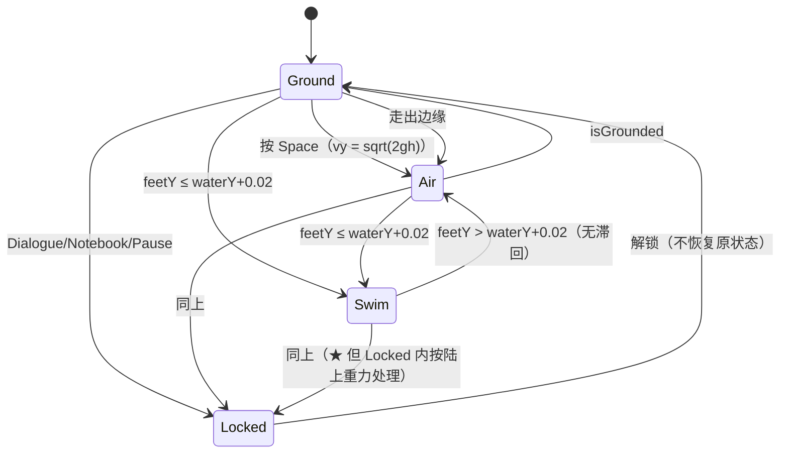

# PlayerController 架构与状态机说明 v1

> 版本：v1（现状勘定 + 目标态提案）
> 代码基准：`Assets/Scripts/Runtime/Player/PlayerController.cs`（379 行，commit `2a984e5`）
> 用途：梳理「玩家指令 → 状态判定 → 物理位移 → 表现」全链路，作为后续游泳模块重构的施工图。

---

## 0. 结论摘要

| 项 | 现状 |
|---|---|
| 状态机形态 | **隐式**：`Update()` 内 4 条 `if` 分支，无状态对象、无 Enter/Exit、无状态时间 |
| 状态数量 | 4（Locked / Ground / Air / Swim）；Run 是 Ground 的速度倍率，不是状态 |
| 唯一移动写者 | `PlayerController`（`CharacterController.Move` 只在此类出现） |
| 输入读取口 | 3 处：`PlayerController`（WASD/Shift/Space/F8）、`ThirdPersonCamera`（MouseXY）、`PlayerInteraction`（E） |
| 状态对外暴露 | 仅 `IsSwimming`（无消费方）+ `Instance` / `CameraPivot` / `Teleport` |
| 主要结构问题 | 空格一键四义、判定顺序隐含、Locked 分支不继承当前状态、表现层双判定源 |
| 游泳模块 | 可跑通主路径，**5 个 P0**（浅水强制游泳、上岸死锁、跳水高速下沉、锁定时下沉、浮位口径错） |

---

## 1. 组件全景

### 1.1 玩家根对象

由 `GameBootstrap.SpawnPlayer()` 运行时生成（无预制体时用 Capsule 兜底）：

| 组件 | 关键参数 | 职责 |
|---|---|---|
| `Transform` | tag=`Player`，layer=`2`(Ignore Raycast) | 位置真源 |
| `CharacterController` | height 1.8 / radius 0.4 / center (0, 0.9, 0) | 碰撞与位移载体 |
| `PlayerController` | 见 §1.3 | 输入 → 移动唯一决策者 |
| `PlayerInteraction` | rayDistance 3.5 / KeyCode.E | 独立 `Update`，与状态机**无耦合** |
| `PlayerWalkDust` | 由 `PlayerController.Awake` 自动挂载 | `LateUpdate` 读 `_cc.isGrounded` + 位移，扬尘 |
| `WaterFoamEmitter` | 由 `PlayerController.MountPlayerFoam()` 自动挂载 | `LateUpdate` 读水面，贴水面显示泡沫 |
| `CameraPivot`（子物体） | 局部 y = 1.15 | 相机跟随点，不是移动控制点 |

### 1.2 相机

`ThirdPersonCamera`（独立对象）：
- 提供 `Yaw` / `Pitch`，`Yaw` 是 `PlayerController` 求移动方向的**唯一朝向来源**；
- 相机自身不写玩家 `transform`，只在 `LateUpdate` 跟随 `CameraPivot`；
- 碰撞收缩只改臂长，不改朝向。

### 1.3 可调参数（Inspector）

| 参数 | 默认 | 语义 |
|---|---|---|
| `moveSpeed` | 5.5 | 陆地步行速度 |
| `sprintMultiplier` | 1.45 | Shift 倍率（编辑器下被 `DebugMoveMultiplier = 3` 顶替） |
| `jumpHeight` | 1.4 | 由 `sqrt(2*g*h)` 反算初速度 |
| `gravity` | -22 | 全程常数 |
| `swimmingEnabled` | true | 游泳总开关（false 时 `TrySample` 短路） |
| `swimMoveSpeed` | 3.0 | 水中水平速度 |
| `ascendSpeed` | 2.2 | 按住空格上浮上限 |
| `sinkSpeed` | 0.55 | 松手缓慢下沉 |
| `floatDepthBelowSurface` | 0.15 | 上浮终点：**脚底**距水面 |
| `swimVerticalSmoothing` | 10.0 | 竖直速度平滑速率（m/s²） |
| `autoMountPlayerFoam` | true | 自动挂泡沫 |

---

## 2. 每帧时序

```
GameBootstrap.Update         F5/F9 存档、F7 小游戏
        ↓
ThirdPersonCamera.Update     读 MouseXY → _yaw/_pitch（InputLocked 时直接 return）
        ↓
PlayerController.Update      ★ 状态机全部逻辑在此
        ↓
PlayerInteraction.Update     射线找 Interactable → E 触发
        ↓
（物理 / CharacterController.Move 内含）
        ↓
ThirdPersonCamera.LateUpdate 跟随 + 相机避让 + 玩家半透明
PlayerWalkDust.LateUpdate    扬尘判定
WaterFoamEmitter.LateUpdate  泡沫贴水面
```

> **关键点 1**：`PlayerController` 用的是**上一帧**的 `ThirdPersonCamera.Yaw`（相机 `Update` 在本帧已先执行，顺序上可用，但存在一帧延迟）。
> **关键点 2**：所有表现层（尘埃 / 泡沫 / 相机淡化）在 `LateUpdate` 读结果，不回写状态 —— 这是对的，保留。

---

## 3. 现状状态模型（隐式四态）

### 3.1 状态定义

| # | 状态 | 判定式（代码位置） | 进入条件 | 退出条件 |
|---|---|---|---|---|
| S0 | **Locked** | `GameEvents.InputLocked`（L160） | 对话 / 笔记本 / 暂停任一为真 | 三者全假 |
| S1 | **Ground** | `_cc.isGrounded`（L171） | 落地且未入水 | 离地 / 入水 / 上锁 |
| S2 | **Air** | `!_cc.isGrounded` | 起跳 / 走下悬崖 | 落地 / 入水 |
| S3 | **Swim** | `inWater`（L209） | `hasWater && feetY ≤ waterY + 0.02` | `feetY > waterY + 0.02` |

`InputLocked = DialogueActive || NotebookOpen || Paused`（`GameEvents.cs:22`）。

### 3.2 迁移图



### 3.3 关键实现事实

1. **状态无载体**：`_grounded` / `IsSwimming` 是两个独立 bool，不存在"当前状态"字段，也没有 `OnStateEnter/Exit`。所有状态副作用散落在分支里。
2. **判定顺序固定**：`F8 调试 → Locked → 重力贴地修正 → 读输入 → 朝向 → 水面采样 → Swim → 跳跃/重力`。顺序即优先级，改一处会牵动全部。
3. **Swim 分支强制 `_grounded = false`**（L227），且 `Move` 之后不重读 `_cc.isGrounded`。
4. **Locked 分支不认游泳态**：直接 `ApplyGravity()` + `Move`（L164-165），水里暂停会持续下沉。
5. **Teleport 是唯一外部写位接口**：先关 `_cc` 再改位再开，`_velocity` 清零，但**不清 `IsSwimming`**（下一帧自愈）。

### 3.4 速度求解规则

| 状态 | 水平 | 竖直 |
|---|---|---|
| Locked | 置 0 | `vy += g·dt` |
| Ground | `wish * moveSpeed * mult`（瞬时赋值） | 落地夹到 -2；按 Space 给跳跃初速 |
| Air | 同上（空中可完整操控） | `vy += g·dt` |
| Swim | `wish * swimMoveSpeed`（不吃 sprint） | `MoveTowards(vy, target, 10·dt)` |

---

## 4. 指令层 × 状态机 交互矩阵

### 4.1 输入源清单

| 输入 | 读取点 | 消费者 |
|---|---|---|
| `Horizontal`/`Vertical`（WASD） | PlayerController L175 | 移动向量 |
| `Mouse X/Y` | ThirdPersonCamera L100 | 相机 Yaw/Pitch → 间接决定移动方向 |
| `LeftShift`/`RightShift` | `CurrentMoveMultiplier()` | 速度倍率（编辑器下被 F8 调试倍率覆盖） |
| `Space` | PlayerController L232 / L272 | **跳跃 / 上浮 / 保持** |
| `E` | PlayerInteraction L48 | 交互 |
| `F5`/`F9`/`F7` | GameBootstrap L65-70 | 存档 / 读档 / 小游戏 |
| `F8` | PlayerController L154 | 调试倍率开关 |

### 4.2 语义矩阵（★ 空格承载四义，是当前最脆的地方）

| 指令 | Locked | Ground | Air | Swim |
|---|---|---|---|---|
| WASD | 吞掉（水平归零） | 全速移动 + 转向 | 空中操控（同速） | 3.0 m/s 移动，转向照常 |
| Shift | 吞掉 | 1.45×（编辑器 3×） | 无效（速度已定） | **无效** |
| Space 按下 | 吞掉 | 跳跃 | 无效 | 上浮（`GetKey` 持续判） |
| Space 保持 | 吞掉 | 无 | 无 | 上浮，接近 `holdY` 自动减速停住 |
| Space 松开 | 吞掉 | — | — | `sinkSpeed` 缓沉 |
| E | 吞掉（清空高亮） | 交互 | 交互 | 交互（水中也能开对话） |
| 鼠标 | 相机冻结 | 旋转相机 | 旋转相机 | 旋转相机 |

### 4.3 指令 → 状态迁移的触发点

```
Input.GetAxisRaw("Horizontal"/"Vertical")
        └─→ wish = Quaternion.Euler(0, yaw, 0) * (x, 0, y)     ← 方向由相机 Yaw 决定
              └─→ planar = wish * (moveSpeed × mult)
                    ├─ Ground/Air：直接写 _velocity.xz
                    └─ Swim    ：按 swimMoveSpeed 重算（丢弃 mult）

Input.GetKeyDown("Space")
        └─ Ground → vy = sqrt(2·|g|·h) → 迁移到 Air
Input.GetKey("Space")     （注意是 GetKey，不是 Down）
        └─ Swim → targetVy = clamp(落差/dt, 0, ascendSpeed)

Input.GetKeyUp("Space")   （隐式，无显式处理）
        └─ Swim → targetVy = -sinkSpeed
```

**结论**：指令层没有统一入口，每个按键在多个分支里被重复读取，同一按键在不同状态语义完全不同，且"按下/保持/松开"三种边沿只有 `Space` 显式区分了两档。

### 4.4 外部系统对状态机的耦合

| 系统 | 耦合方式 | 风险 |
|---|---|---|
| `GameEvents.InputLocked` | 全局静态 bool | 单点否决，但状态机不记录"被谁锁" |
| `ThirdPersonCamera.Yaw` | 每帧读 | 相机缺失时用 `Camera.main` 兜底，再退 `cameraPivot` |
| `WaterSurface.TrySample` | 每帧静态查询（全场景遍历 + 自动注册） | 水面识别失败 → 静默不进游泳 |
| `WaterCollisionFilter` | 运行时 `IgnoreCollision` | 让玩家穿过水面，但**也让玩家无法借水面 Collider 借力** |
| `LevelTeleport` / `SaveService` | 调 `Teleport()` | 不重置 `IsSwimming` / `_grounded` |
| `WaterFoamEmitter` / `PlayerWalkDust` | 只读 `transform` / `_cc.isGrounded` | 与状态机判定不同源 → 表现不一致 |

---

## 5. 结构性缺陷（与游泳无关，先记账）

| # | 问题 | 影响 |
|---|---|---|
| A1 | `Update()` 单函数约 95 行，4 分支 + 内联物理，无状态对象 | 每加一个状态（攀爬/坐下/推车）都要改主流程 |
| A2 | 无 Enter/Exit 钩子 | 状态切换的副作用（清速度、换动画、切相机）只能就地写，容易漏 |
| A3 | Locked 分支是"另一个 Update"，不复用任何状态逻辑 | 水里暂停会沉底；游泳/跳跃规则被绕过 |
| A4 | 状态判定与表现判定双源（`IsSwimming` vs `p.y < waterY`） | 动画/泡沫/游泳三者可能不同步 |
| A5 | 无状态时间/最小驻留 | 边界处可高频抖动 |
| A6 | 空格键无输入层抽象 | 新增"下潜"（Ctrl）时无法优雅扩展 |
| A7 | `MainCharacter.cs` 是空壳 stub（注释说明已被 `PlayerController` 取代） | 历史残留，勿再引用 |

---

## 6. 游泳模块问题清单

> **状态更新（2026-11-05）**：S1~S5 已按下述决策落地补丁，改动见 §9。S6~S17 仍未处理。

> 基准：`PlayerController.cs` L201-289 + `WaterSurface.cs` + `WaterFoamEmitter.cs`。
> 分级：P0 = 破坏玩法闭环 / 必现；P1 = 明显手感或表现错误；P2 = 技术债。

### P0

| ID | 位置 | 现象 | 根因 | 修法 |
|---|---|---|---|---|
| **S1 浅水强制游泳** | L209 + L227 | 站进 0.1m 深的水里就进游泳态：不能跳、不能扬尘、动画变 falling，只能"贴地游" | `inWater` 只判 `feetY ≤ waterY+0.02`，没有水深概念；Swim 分支强制 `_grounded=false` | 引入 `depth = waterY - feetY`；`_grounded && depth < wadeDepth(0.5~0.6)` 走 Ground（可按深度减速），否则进 Swim |
| **S2 上岸死锁** | L223-230 + L232 | 深水贴岸上不去。水面 Collider 被 `IgnoreCollision`，跳跃在 Swim 态不可达，只能靠 CC 顶斜坡 | Swim 分支提前 `return`，跳跃逻辑永不可达；无出水辅助 | ①Swim 态允许按 Space 触发"蹬水上岸"（前向 + 向上脉冲，检测前方 0.6m 有可站面才放行）；②或做正反两向的 ledge probe |
| **S3 跳水像石头** | L287 | 从 6m 跳进深水，入水后仍以 ~11 m/s 下沉近 1 秒，常直接砸到池底/穿出水体判成出水 | `MoveTowards` 速率仅 10 m/s²，从自由落体速度收敛回 `-sinkSpeed` 需要 `(v-sink)/10` 秒 | 入水首帧 `_velocity.y = Mathf.Max(_velocity.y, -sinkSpeed)`，或给 0.15s 入水阻尼 |
| **S4 暂停/对话中沉底** | L160-169 | 水里打开笔记本或对话，角色一直下沉，关闭后人在池底且贴死 | Locked 分支固定走 `ApplyGravity()`，不认游泳态；`IsSwimming` 不更新 | Locked 分支按"上锁前状态"处理：Swim 时 `vy = 0`（或保留轻微浮力），并维持 `IsSwimming` |
| **S5 浮位口径错** | L32 + L269 | 默认只淹到脚踝（CC 高 1.8m，0.15 在脚底），人整体露在水面上，像站在水面上 | `holdY = waterY - floatDepthBelowSurface` 是**脚底**口径，与"露头游泳"意图差一个身高 | 改为"头顶距水面"口径：`holdY = waterY - (ccHeight - headClearance)`，或直接给 `swimFloatRatio`（如 0.75 × 身高） |

### P1

| ID | 位置 | 现象 | 根因 | 修法 |
|---|---|---|---|---|
| S6 进出水抖动 | L209 | 边界处 `[Swim] 入水/出水` 可高频翻转，泡沫/动画闪 | 单阈值 0.02；`waterY` 来自 `Renderer.bounds.max.y`（含波动/泡沫层），`feetY` 来自 CC bounds（受 skinWidth/stepOffset 影响） | 双阈值（进 `≤ waterY+0.05`，出 `> waterY+0.12`）+ 0.15s 最小驻留 |
| S7 泡沫与游泳判定不同源 | `WaterFoamEmitter.cs:146` | 齐腰水：泡沫已出现但玩家还在 Ground；浅水游泳：泡沫时有时无 | 泡沫判 `transform.position.y < waterY`（CC 中心），游泳判 `feetY` | 由 `PlayerController` 广播 `IsSwimmingChanged` 事件，泡沫订阅；删掉自身判定 |
| S8 无游泳动画 | L296-297 | 水里播 falling / `Speed=3` 的走跑混合 | Animator 只喂 `Speed` / `Grounded` / `Jump`；全仓库 `.controller` 无 `Swimming` 参数 | 加 `Swimming`(bool) + `SwimSpeed`(float)；无动画资产时先做程序化前倾姿态 |
| S9 上浮响应延迟 | L287 | 松手状态按空格，前 0.25s 仍在沉 | 平滑速率 10 m/s²，从 -0.55 到 +2.2 需 0.275s | 上浮用更大加速度（~40）或直接置速；下沉保留平滑 |
| S10 水面识别绑死第三方材质 | `WaterSurface.cs:132/156`、`WaterCollisionFilter.cs:31` | 场景只摆自研 `Custom/StylizedInteractiveWater` 时：不入水、无泡沫，且自研水面 Collider 仍挡人（不会被 IgnoreCollision） | 自动注册/碰撞过滤都用 `_WaterfallTurbulencePose` 材质探针，只有第三方 `S_Water.shadergraph` 带它 | 加显式 `IWaterVolume` / `isWater` 标记，材质探针降级为兜底 |
| S11 多水面取近策略 | `WaterSurface.cs:115-124` | 深水底部玩家离旁边浅水片更近时会取错水面高度，被误判出水 | `TrySample` 取"竖直距离最近"，不保证选到"包住玩家的那片" | 先按 XZ 包含过滤，再取"高于脚底的最低面"（或按体积包含） |

### P2

| ID | 位置 | 说明 |
|---|---|---|
| S12 | `WaterSurface.Contains` L91 | 用 Renderer AABB 判 XZ：L 形/带岛水体把空气判成水；`edgePadding 0.15` 进一步放大误判 |
| S13 | `WaterCollisionFilter.Update` L57 | 每 0.5s 全场景 `FindObjectsOfType<Renderer>()` + 逐材质 `HasProperty` + 每 renderer 取全部 Collider；`s_done` 只增不清。改事件驱动/一次性 |
| S14 | L178-179、`ThirdPersonCamera.cs:37` | 中文注释已被 ASCII 化（`?` 字节），原意永久丢失，需重写 |
| S15 | L263 | 游泳无惯性/水阻，速度瞬时赋值；不吃 sprint（需确认是否为设计意图） |
| S16 | `CameraPivot` y=1.15 固定 | 游泳时相机高度不变，无水下雾/色偏；`IsSwimming` 未被相机、UI、音效任何一方消费 |
| S17 | 场景资产 | `Mechanics_Code.unity` 磁盘上 **0 个 `WaterSurface` 组件**，全靠运行时按材质自动注册；叶子/PlayerFoam 实例亦未存盘 |

---

## 7. 目标态提案（待审核后施工）

### 7.1 分层

```
[Input Layer]  PlayerInputSource  →  PlayerCommand（每帧快照，含边沿标记）
                        │
[Resolve Layer]  LocomotionSensor  →  EnvironmentProbe
                 （grounded / waterDepth / waterY / 是否有可爬面）
                        │
[State Layer]    PlayerStateMachine（显式状态对象 + 迁移表 + 最小驻留）
                 Locked / Ground / Air / Swim / Climb
                        │
[Apply Layer]    MotionApplier（唯一写 _cc.Move 的地方）
                        │
[Present Layer]  AnimatorBridge / FoamBridge / CameraBridge（订阅状态变化）
```

### 7.2 指令结构体

```csharp
struct PlayerCommand {
    Vector2 move;        // 已归一化
    bool sprint;
    bool jumpPressed;    // 上升沿
    bool jumpHeld;       // 持续
    bool crouchHeld;     // 预留下潜
    float cameraYaw;
    bool inputLocked;
}
```

### 7.3 迁移表（建议）

| From | To | 条件 | 副作用 |
|---|---|---|---|
| Ground | Jump | `jumpPressed && grounded` | `vy = jumpImpulse`，触发 Jump 动画 |
| Ground | WalkIntoWater | `depth ≥ wadeDepth` | 播入水 VFX/音效，切 Swim |
| Ground | Locked | `inputLocked` | 记 `_stateBeforeLock` |
| Air | Swim | `depth ≥ wadeDepth` | `vy = max(vy, -sinkSpeed)`，入水 VFX |
| Swim | Ground | `grounded && depth < wadeDepth` | 复原陆地参数 |
| Swim | ClimbOut | `jumpPressed && 前方可站` | 位移脉冲 + 动画 |
| Swim | Locked | `inputLocked` | `vy = 0` |
| Air | Ground | `grounded` | 落地 VFX，`vy` 夹到 -2 |
| Locked | `_stateBeforeLock` | `!inputLocked` | 按进入时的状态恢复（含 Swim） |

### 7.4 统一语义表（空格）

| 状态 | Space 按下 | Space 保持 | Space 松开 |
|---|---|---|---|
| Ground | 跳跃 | — | — |
| Air | — | — | — |
| Swim | 上浮脉冲 | 持续上浮 | 缓沉 |
| Swim + 贴岸 | 蹬水上岸 | — | — |
| Locked | 吞掉 | 吞掉 | 吞掉 |

---

## 8. 待拍板（影响施工顺序）

1. **游泳姿态口径**：要「站立踩水」（现状 0.15 脚底）还是「露头游泳」（身体 70~80% 入水）？决定 S5 改法。
2. **浅水是否保留涉水态**：脚能着地时按走路处理（可跳跃），还是统一游泳？决定 S1。
3. **Swim 态是否允许跳跃**：允许（解决 S2 死锁，最省事）还是单独做攀爬上岸？
4. **重构范围**：只修 S1~S5（原地补丁，1~2 小时）还是顺手把 §7 状态机拆出来（半天，后续加状态成本归零）？

---

## 附：一句话版本

> 当前是一个「一个 `Update` + 四个 `if`」的隐式状态机：优先级固定为 `Locked > Swim > 跳跃/重力`，空格一键四义，状态无载体、无 Enter/Exit、无滞回；游泳模块主路径能跑，但**浅水不能走、深水上不了岸、跳水高速砸底、暂停会沉底、浮位只淹脚踝**这五条必须先修。

---

## 9. 实施记录（2026-11-05 · S1~S5 原地补丁）

### 9.1 拍板结果

| 项 | 决策 | 落地方式 |
|---|---|---|
| 浮位口径 | 身体 **40%~50%** 入水（鸭子半身观感） | `swimSubmergeRatio = 0.45`，浮位线 = `waterY - body.size.y × ratio` |
| 浅水 | **统一游泳**（不保留涉水态） | 去掉「浅水走路」分支；脚在水里就进 Swim |
| 水底起浮 | **必须能按空格从水底浮起** | 浮位线高于脚底时正常上浮；脚底已高于浮位线（浅水）→ 目标 vy=0，站在底上不动 |
| Swim 起跳 | **不允许** | Swim 分支不接跳跃；改用「蹬岸」解决上岸 |
| 重构范围 | 只修 S1~S5 | 不改状态机结构，不改 Animator |

### 9.2 代码改动

`Assets/Scripts/Runtime/Player/PlayerController.cs`

| 项 | 改动 |
|---|---|
| S5 浮位 | `floatDepthBelowSurface`（脚底口径）→ `swimSubmergeRatio`（Range 0.2~0.75，默认 0.45） |
| S1 统一游泳 | 删除 `_grounded` 优先的涉水分支，入水即 Swim；浅水踩底时靠浮位线自然站住 |
| S2 上岸 | 新增 `swimExitAssist`（不是跳跃）：Space + 朝岸 + 前方 0.85m 有墙 + 岸面高差 ≤ 1.0m → 0.32s 脚本位移蹬上岸；带 0.45s 冷却、传送/禁用时自动打断 |
| S3 跳水 | 入水首帧 `_velocity.y = max(vy, -sinkSpeed)`，吃掉自由落体冲击 |
| S4 锁输入 | 环境采样提前到分支之前；`InputLocked` 时若在水中 `vy = 0`，不再下沉 |
| 附带 | 修复 L178-179 中文注释乱码；`ThirdPersonCamera.L37` 注释同步修复 |

`Assets/_Project/Scripts/Water/WaterFoamEmitter.cs`
- 被淹判定从「胶囊中心在水面下」改为「`CharacterController.bounds.min.y` 在水面下」，与游泳判定同源（否则 45% 入水时中心已在水面上方，泡沫永远不显示）。

`Assets/Scripts/Runtime/Player/PlayerWalkDust.cs`
- 游泳态不再扬尘（浅水踩底时 `isGrounded` 仍为真，会拖土）。

### 9.3 仍需实机验证

| # | 验证点 | 期望 |
|---|---|---|
| 1 | 站到水里 | 身体约 45% 入水，漂在浮位线不抖 |
| 2 | 池底按住空格 | 匀速上浮到浮位线后停住，不越过 |
| 3 | 岸边按住空格 + 朝岸推 | 0.3s 内蹬上岸，不来回弹 |
| 4 | 6m 高台跳水 | 入水瞬间速度被吃掉，不再砸底 |
| 5 | 水里打开笔记本 / 对话 | 停在原位，关掉后位置不变 |
| 6 | 浅水 0.2m 处 | 站在水底、不沉不浮，可按空格（无效果但不会卡死） |

### 9.4 遗留（本次不动）

S6 进出水滞回、S7 泡沫事件化、S8 游泳动画、S9 上浮手感、S10 `IWaterVolume` 显式标记、S11~S17。

---

## 10. 线上 BUG 修复记录（2026-11-05 第二轮）

| # | 现象 | 根因 | 修法 |
|---|---|---|---|
| B1 | 起跳入水并按住空格 → 角色停在水面高度「漂」着，几乎不没入水却已是游泳态 | ①入水钳速只钳了下限，跳跃的上冲速度被带进水里；②`SwimStep` 里 `toFloatLine < 0`（人还在浮位线之上）时按 `holdJump` 给了 `targetVy = 0`，角色停在入水那一帧的高度，永远沉不到 45% 浮位 | ①入水首帧 `vy = Clamp(vy, -sinkSpeed, 0)`，上下两端都吃掉；②`toFloatLine <= 0` 时一律给下沉速度 `-Clamp(|toFloatLine|*2, sinkSpeed, ascendSpeed)`，离浮位线越远沉得越快 |
| B2 | 走进圆弧形水面，相机瞬间贴到鸭子脸上 | **`Physics.IgnoreCollision` 只影响碰撞解算，不影响 Raycast / SphereCast 查询**。玩家能穿过水面，但相机的 SphereCast 仍被水面 Collider 挡住 → 臂长收到 0 | `WaterSurface` 增加水面 Collider 注册表（`RegisterWaterCollider` / `IsWaterCollider`），由 `WaterSurface.OnEnable` 与 `WaterCollisionFilter.Scan` 双向登记；`ThirdPersonCamera.SolveArm` / `WorldOverlap` 跳过水面 Collider |
| B3 | 带方向键入水后，按空格上浮，鸭子在循环走路动画 | `duck.controller` 只有 `idle` / `walk` / `jump` 三态，无游泳态。Swim 时仍按真实水平速度喂 `Speed=3` → 进 `walk` 循环；同时 `Grounded=false` 会让 `jump→idle/walk` 的过渡条件永远不满足 | `UpdateAnimator` 在 `IsSwimming` 时喂 `Speed=0` + `Grounded=true`（回到 idle）。有游泳 clip 后替换成专用参数 |

### 10.1 待补

- 游泳表现目前借用 `idle`，鸭子在水里会「站着漂」。要真做游泳，需要一张 `Swim` 状态 + 参数（`Swimming` bool / `SwimSpeed` float），这属 S8。
- `WaterSurface` 的碰撞体注册表是静态 HashSet，不清理；换场景时如需重置，调 `WaterSurface` 侧新增的清理入口（尚未提供）。
